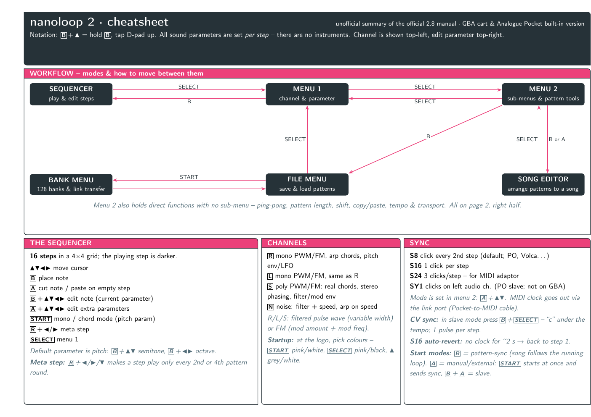
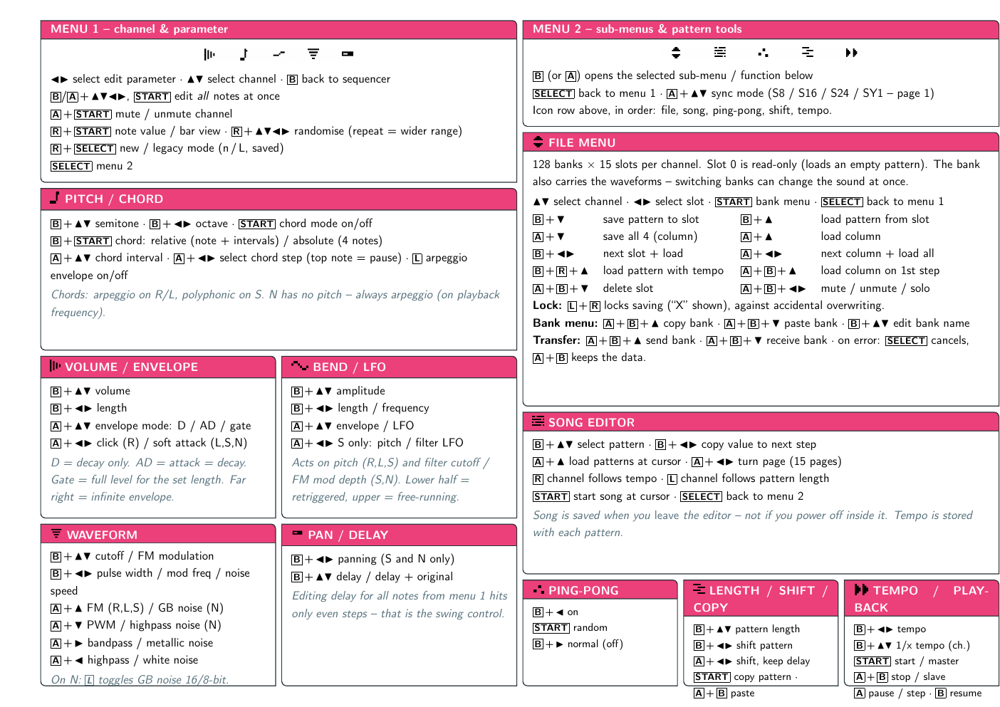

# nanoloop 2 cheatsheet

A two-page, print-ready cheatsheet for **nanoloop 2** (Game Boy Advance
cartridge and the Analogue Pocket built-in version), condensed from the
official nanoloop 2.8 manual. A4 landscape, built with LaTeX +
[tcolorbox](https://ctan.org/pkg/tcolorbox) (`tcbposter`).




## What's covered

**Page 1 — overview & playing**

- Workflow flowchart: how to move between sequencer, menu 1, menu 2,
  file menu, song editor and bank menu
- The sequencer: placing/cutting notes, editing, meta steps
- The four channels (R, L, S, N) and startup colour schemes
- Sync: S8/S16/S24/SY1 analog clock, MIDI clock via link port, CV sync,
  start modes

**Page 2 — the two menus, split in halves**

Left half — menu 1 and the five per-step parameters, each titled with
its original on-device icon: volume/envelope, pitch/chord, bend/LFO,
waveform, pan/delay.

Right half — menu 2 and its entries, also with their original icons:
file menu (save/load patterns and columns, delete, solo/mute, lock,
bank menu & link transfer), song editor, ping-pong, pattern
length/shift/copy, tempo & playback.

## Build

Requires a TeX Live installation with `tcolorbox` (incl. the `poster`
library), `geometry` and `amssymb` — e.g. on Debian/Ubuntu:
`texlive-latex-base texlive-latex-extra latexmk`.

```sh
make            # builds nanoloop2-cheatsheet.pdf
make preview    # also renders preview-page-1.png / preview-page-2.png
make clean      # removes auxiliary files
```

## Source & disclaimer

Unofficial fan-made summary. All content is condensed from the official
nanoloop 2.8 manual by Oliver Wittchow:
<https://nanoloop.com/two/nanoloop28.html>

The parameter and menu icons in `icons/` are the original pixel art
from that manual, upscaled with nearest-neighbour scaling (white made
transparent for the box titles). They remain © Oliver Wittchow and are
reproduced here for reference.

nanoloop is a product of Oliver Wittchow (nanoloop.com). This cheatsheet
is not affiliated with or endorsed by him. In case of doubt, the
official manual wins.

## License

The LaTeX code and layout in this repository are released under the
[MIT License](LICENSE). The underlying nanoloop documentation remains
© its author.
